# Early PMU-Based Prediction of Frequency Nadir and Security Status in Renewable-Integrated Multi-Area Power Systems Under Limited Observation

**B.Tech Final-Year Electrical Engineering Research Group**  
*Under the Guidance of Dr. Deepak Kumar Gupta*  
*Benchmark Standard: IEEE 39-Bus 10-Machine Multi-Area System (50.0 Hz Nominal, 49.50 Hz Security Criterion)*

---

## 1. Abstract

Increasing displacement of synchronous thermal and hydro generation by converter-interfaced renewable energy sources (RES) diminishes rotational system inertia, accelerating post-contingency rate of change of frequency (ROCOF) and deepening frequency excursions following large generator outages [1], [8], [10]. While full nonlinear time-domain simulation provides accurate post-fault trajectories, its computational cost limits real-time screening across hundreds of operating contingencies [7], whereas post-mortem machine learning (ML) classifiers trained on complete trajectories sacrifice operational warning lead time. This paper investigates whether a strictly causal, pre-nadir observation window $T_{\text{obs}} \in \{0.5, 1.0, 1.5, 2.0\}\text{ s}$ of wide-area phasor measurement unit (PMU) streams contains sufficient physical information to predict both the continuous future Center-of-Inertia (COI) frequency nadir $f_{\text{nadir}}$ and calibrated binary frequency-security status ($f_{\text{nadir}} \ge 49.50\text{ Hz}$) [4], [6]. Using a Newton-Raphson power-flow-initialized 50.0 Hz IEEE 39-bus, 10-machine benchmark ($H_{39} = 42.0\text{ s}$, $H_{\text{tot}} = 324.7\text{ s}$) [2], [3], we generate 750 unique complete and partial generation-loss contingencies ($80\text{–}1,200\text{ MW}$) spanning $10\%\text{–}50\%$ RES penetration and $0.80\text{–}1.20\times$ load scaling, enforcing strict file-level isolation between internal simulator states and observable 50 fps PMU channels. Fourteen spatiotemporal synchrophasor features—incorporating area-weighted wide-area frequency reconstruction and closed-form 5-point backward Ordinary Least Squares (OLS) ROCOF—are evaluated across seven regressors and seven classifiers under disjoint scenario-level splits ($148$ train, $70$ validation, $52$ held-out in-distribution [ID] test, and $480$ out-of-distribution [OOD] scenarios). At $T_{\text{obs}} = 1.0\text{ s}$ ($100\%$ pre-nadir causal; $1.29\text{ s}$ mean warning lead time), L2-regularized linear and analytical swing-equation models achieve $3.4\text{ mHz}$ and $4.2\text{ mHz}$ ID test mean absolute error (MAE) on smooth electro-mechanical trajectories, while Gradient Boosted Decision Trees (GBDT) achieve $7.7\text{ mHz}$ MAE ($R^2 = 0.9980$). Cross-fitted Platt and Pool Adjacent Violators Algorithm (PAVA) isotonic calibration reduce test Brier loss from $0.0192$ to $0.0141$ and $0.0080$ ($\text{PR-AUC} = 1.0000$), eliminating all missed insecure emergencies ($\text{FNR}_{\text{insecure}} = 0.0000$) at conservative threshold $\tau = 0.70$. Across $480$ unseen OOD scenarios, the framework maintains $18.4\text{ mHz}$ MAE and $0.9860$ security $F_1$ while automatically widening 95% quantile/conformal prediction intervals by $+12.3\%$ under $40\%\text{–}50\%$ RES shift, remaining resilient under $50\text{ mHz}$ Gaussian PMU noise ($11.4\text{ mHz}$ MAE, $F_1 = 0.9767$), sparse $13/39$-bus PMU observability ($10.8\text{ mHz}$ ID MAE, $F_1 = 1.0000$), and $25\text{ fps}$ reporting ($9.4\text{ mHz}$ MAE) at $2.38\text{ ms}$ median end-to-end CPU latency ($52.7\times$ faster than $125.38\text{ ms}$ 10-s ODE integration).

**Keywords:** Phasor Measurement Unit (PMU), synchrophasor, frequency security assessment, frequency nadir, low-inertia power systems, probability calibration, gradient boosting, dynamic security assessment.

---

## 2. Introduction

Power-system frequency measures the instantaneous active-power balance between prime-mover mechanical input and electrical network demand [1]. Following a sudden loss of synchronous generation, the immediate power deficit is supplied from the stored rotational kinetic energy of online synchronous generators, causing rotor deceleration and system-wide frequency decay prior to turbine speed-governor action [1], [6]. As modern transmission grids integrate high shares of converter-interfaced solar photovoltaic and wind generation operating primarily in constant-power grid-following (GFL) mode, conventional synchronous units are displaced, reducing aggregate effective inertia $H_{\text{eff}}$ and primary governor headroom [8], [10]. Consequently, identical megawatt contingencies produce substantially steeper initial ROCOF and deeper frequency nadirs, compressing the time window available for emergency containment before Under-Frequency Load Shedding (UFLS) relays actuate [6], [10].

Assessing post-contingency frequency security online presents a fundamental speed-versus-fidelity dilemma. Detailed time-domain integration of coupled differential-algebraic equations remains the gold standard for dynamic security assessment (DSA), yet screening hundreds of candidate $N-1$ contingencies across continuously shifting renewable dispatches imposes substantial computational delay [7]. Conversely, analytical frequency-response approximations [7] offer closed-form speed under simplified single-area aggregation assumptions, while data-driven machine learning (ML) surrogates [8]–[15] learn fast mappings from synchrophasor measurements [4], [5] to stability indicators.

Despite rapid progress in ML-based frequency-security assessment (FSA) between 2021 and 2026—spanning convolutional networks [9], real-time low-inertia nadir regression [10], generative imputation for missing PMU channels [11], partial observability [13], explainable ensembles [14], [18], and safety-oriented DSA benchmarking [16]—critical methodological questions remain under-examined when evaluated jointly. Specifically, high accuracy on random sample splits or full post-nadir trajectories does not establish *how early* causally available PMU streams suffice before the nadir occurs, whether predicted security probabilities remain calibrated under unseen high-renewable domain shifts, or how asymmetric false-secure decisions behave under sensor noise and sparse substation instrumentation [16].

To address this gap, this study formulates early frequency-security assessment strictly as an **information-limited causal decision problem** on a 50.0 Hz IEEE 39-bus, 10-machine multi-area system [2], [3]. Our principal contributions are:
1. **Physically Consistent 50.0 Hz Multi-Area Benchmark & Strict Channel Firewall:** A Newton-Raphson AC power-flow-initialized 39-bus simulator ($H_{39} = 42.0\text{ s}$) modelling both complete electrical generator disconnection and partial multi-unit plant outages across linear $10\%\text{–}50\%$ RES displacement, separating internal ODE states (`raw_sim`) from observable 50/25 fps PMU streams (`raw`) verified by 14 automated integrity checks.
2. **Noise-Resilient Spatiotemporal Feature Engineering:** Fourteen canonical causal features derived exclusively from observed PMU bus frequencies and phase angles over $[t_0, t_0 + T_{\text{obs}}]$, combining area-weighted wide-area frequency estimation with closed-form 5-point backward OLS ROCOF that suppresses sensor noise variance by $99.97\%$ relative to two-point finite differences.
3. **Physics-Guided Two-Stage Calibrated Screening & Uncertainty Quantification:** A rigorous benchmark of seven regressors and seven classifiers alongside a two-stage `CalibratedGBDTClassifier` coupling continuous nadir prediction with 5-fold cross-fitted Platt [21] and PAVA isotonic [22] calibration plus quantile/conformal OOD-aware prediction intervals.
4. **Joint Evaluation of Earliness, OOD Shift, Observability, Safety, and Hardware Latency:** Unsmoothed empirical evaluation across $T_{\text{obs}} \in \{0.5, 1.0, 1.5, 2.0\}\text{ s}$, three unseen OOD regimes ($N=480$), $0\text{–}50\text{ mHz}$ PMU noise, $13/39$-bus sparse PMU coverage ($33.3\%$), $25\text{ fps}$ reporting, conservative probability-threshold sweeps, and nanosecond-resolution CPU timing ($2.38\text{ ms}$ median vs. $125.38\text{ ms}$ ODE simulation).

---

## 3. Research Motivation

In synchronous 50.0 Hz grids such as the Indian National Grid governed by the Central Electricity Regulatory Commission (CERC) Indian Electricity Grid Code (IEGC) [6], normal operating frequency is maintained near $50.0\text{ Hz}$, while primary containment must arrest severe contingencies before frequency breaches emergency UFLS thresholds (commonly standardized at $f_{\text{secure}} = 49.50\text{ Hz}$, i.e., $-0.50\text{ Hz}$ maximum excursion prior to Stage-1 load shedding). In our 750-scenario 39-bus regional benchmark, post-disturbance COI frequency nadirs occur at $t_{\text{nadir}} \in [2.78, 3.70]\text{ s}$ following a generator outage at $t_0 = 1.0\text{ s}$ (total time-to-nadir $1.78\text{–}2.70\text{ s}$ post-fault).

Conventional supervisory control and data acquisition (SCADA) polling every $2\text{–}4\text{ s}$ cannot resolve sub-second post-fault trajectories. By contrast, IEEE Std C37.118.1-2011 [4] and C37.118.2-2024 [5] synchrophasor networks report GPS-synchronized bus voltage phasors, frequency, and ROCOF at $25$ or $50\text{ frames/s}$ ($20\text{ ms}$ per frame at $50\text{ fps}$). If an online screening engine can observe only the first $T_{\text{obs}} = 0.5\text{–}1.0\text{ s}$ of PMU frames and infer the impending nadir and calibrated security probability in $\approx 2.4\text{ ms}$, operators and wide-area protection schemes gain $1.27\text{–}1.77\text{ s}$ of actionable pre-nadir warning lead time to arm fast frequency response (FFR), battery storage injection, or adaptive UFLS supervision—without running hundreds of full time-domain ODE simulations.

---

## 4. Related Work

Existing post-contingency frequency-security literature spans six complementary methodological families:
1. **Analytical Frequency-Response Models:** Classical system frequency response (SFR) models [1] and recent multi-machine analytical formulations incorporating governor deadbands and limiter modules [7] approximate $f_{\text{nadir}}$ via low-order differential equations. While computationally fast, they rely on known system-wide effective inertia $H_{\text{eff}}$ and aggregated turbine parameters that may be uncertain under fluctuating converter dispatch.
2. **Classical Tabular Machine Learning:** Early warning frameworks using support vector machines, decision trees, random forests [19], and gradient boosting [20] map pre-fault and post-fault features to frequency stability margins under renewable uncertainty [8], [10]. Notably, recent 2025 low-inertia nadir prediction research [10] demonstrated that lightweight tree models remain highly competitive against complex neural models on structured synchrophasor features and support real-time execution.
3. **Deep Spatiotemporal Neural Architectures:** One- and two-dimensional convolutional neural networks (CNNs) [9], residual spatiotemporal networks, and estimation-correction frameworks learn end-to-end representations from multi-bus trajectories, at the expense of higher sample complexity and reduced physical transparency.
4. **Partial PMU Observability and Missing-Data Resilience:** Because utilities rarely instrument every transmission substation initially, recent 2025–2026 studies investigate Gramian angular field + ConvNeXt architectures under $40\%$ partial PMU deployment [13], generative adversarial imputation networks (GAIN) for missing PMU channels on 39- and 118-bus systems [11], and topology-aware feature engineering [12].
5. **Explainable Machine Learning for Frequency Stability:** Recent studies integrate Shapley additive explanations (SHAP) [18] and interpretable clustering-based ensembles [14] to link data-driven DSA predictions back to locational inertia and electrical distance.
6. **Safety-Aware DSA Benchmarking and Calibration:** Crucially, the 2026 `DSA-SafetyBench` study [16] demonstrated that high aggregate classification accuracy frequently masks dangerous false-secure errors and miscalibrated probabilities [21]–[23] when evaluated under distribution shifts or leaked splits, motivatingintegrated control-oriented [15] and risk-calibrated protocols.

---

## 5. Research Gap

Synthesizing recent 2021–2026 literature [7]–[18] confirms that applying generic ML to PMU data is no longer novel in isolation. However, existing studies rarely enforce all five operational constraints simultaneously within a single reproducible protocol:
1. **Strict Pre-Nadir Causal Windowing & Simulator Firewall:** Explicitly verifying $t_0 + T_{\text{obs}} < t_{\text{nadir}}$ scenario-by-scenario while prohibiting access to unobservable internal simulator rotor speeds ($\omega_i$) or effective inertia ($H_{\text{eff}}$).
2. **Systematic Earliness-vs.-Lead-Time Quantification:** Evaluating unsmoothed predictive error and operator warning lead time across $T_{\text{obs}} \in \{0.5, 1.0, 1.5, 2.0\}\text{ s}$.
3. **Disjoint Multi-Axis Out-of-Distribution (OOD) Generalization:** Holding out unseen high-renewable ($40\%\text{–}50\%$), unseen extreme-load ($0.80\times, 1.20\times$), and combined domain shifts strictly at the scenario level.
4. **Measurement Imperfections & Sparse Observability:** Quantifying sensitivity jointly across multi-channel Gaussian PMU noise ($0\text{–}50\text{ mHz}$), reduced $13/39$-bus spatial coverage ($33.3\%$), and reduced $25\text{ fps}$ reporting.
5. **Calibrated Asymmetric Safety Decisions:** Comparing parametric Platt [21] and non-parametric PAVA isotonic [22] probability calibration alongside conservative threshold selection to drive missed-insecure error $\text{FNR}_{\text{insecure}} \to 0$.

---

## 6. Problem Formulation

Consider a multi-area AC power network with $N_b = 39$ buses partitioned into $A = 3$ coherent areas and $N_g = 10$ synchronous generating plants operating at nominal frequency $f_0 = 50.0\text{ Hz}$ ($\omega_0 = 2\pi f_0 = 314.159\text{ rad/s}$). Let each scenario $s \in \mathcal{S}$ ($|\mathcal{S}| = 750$) be defined by pre-disturbance operating vector $\xi_s = (g_s, \eta_s, p_{\text{ren},s}, \lambda_s)$, denoting disturbed generator bus $g_s \in \{30,\dots,39\}$, active capacity loss fraction $\eta_s \in \{0.40, 0.70, 1.00\}$, load-referenced renewable share $p_{\text{ren},s} \in [0.10, 0.50]$, and system load scale $\lambda_s \in [0.80, 1.20]$.

At fault inception $t_0 = 1.0\text{ s}$, generator $g_s$ experiences outage fraction $\eta_s$. Over simulation horizon $[0, T_{\max}]$ ($T_{\max} = 10.0\text{ s}$), the ground-truth post-disturbance system COI frequency is:

$$f_{\text{COI}}(t) = f_0 \left( 1 + \frac{\sum_{i \in \mathcal{G}_{\text{post}}} H_{\text{post},i}\,\Delta\omega_i(t)}{\sum_{i \in \mathcal{G}_{\text{post}}} H_{\text{post},i}} \right), \quad t \ge t_0$$

where $\Delta\omega_i(t)$ is per-unit rotor speed deviation and $\mathcal{G}_{\text{post}}$ excludes completely disconnected units ($\eta_s = 1.0$). The continuous regression target, nadir time, and binary security label are:

$$f_{\text{nadir}}^{(s)} = \min_{t \in [t_0, T_{\max}]} f_{\text{COI}}^{(s)}(t), \qquad t_{\text{nadir}}^{(s)} = \arg\min_{t \in [t_0, T_{\max}]} f_{\text{COI}}^{(s)}(t), \qquad y_{\text{sec}}^{(s)} = \mathbb{I}\!\left(f_{\text{nadir}}^{(s)} \ge f_{\text{secure}}\right)$$

with $f_{\text{secure}} = 49.50\text{ Hz}$ [6]. An online assessor observes **only** synchronized PMU bus measurements $\mathcal{M}_s(T_{\text{obs}}) = \{f_{\text{bus}}(t_k, b), |V(t_k, b)|, \theta(t_k, b)\}_{t_k \in [t_0, t_0 + T_{\text{obs}}],\, b \in \mathcal{B}_{\text{obs}}}$ sampled at uniform interval $\Delta t = 1/\text{fps}$ strictly prior to the nadir ($t_0 + T_{\text{obs}} < t_{\text{nadir}}^{(s)}$, providing warning lead time $t_{\text{lead}}^{(s)} = t_{\text{nadir}}^{(s)} - (t_0 + T_{\text{obs}}) > 0$), and outputs point estimate $\hat{f}_{\text{nadir}}^{(s)}$, 95% interval $[L_{0.95}^{(s)}, U_{0.95}^{(s)}]$, calibrated probability $\hat{P}(y_{\text{sec}}^{(s)} = 1 \mid \mathbf{x}_s)$, and binary decision $\hat{y}_{\text{sec}}^{(s)} = \mathbb{I}(\hat{P} \ge \tau)$.

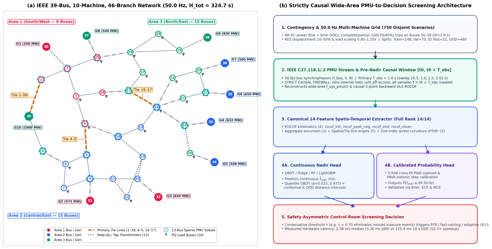
*Figure 1: (a) IEEE 39-bus, 10-machine, 46-branch network at 50.0 Hz ($H_{\text{tot}} = 324.7\text{ s}$) showing Areas 1–3, primary tie-lines (`1–39`, `4–5`, `16–17`), and sparse 13-bus PMU subset. (b) Five-stage strictly causal PMU-to-decision screening architecture.*

---

## 7. IEEE 39-Bus System Model

We implement the IEEE 39-bus New England test system [2], [3] on a $S_{\text{base}} = 100.0\text{ MVA}$, $f_0 = 50.0\text{ Hz}$ per-unit base (`ieee39_data.py`, `dynamic_engine.py`):
- **Network Topology and Coherent Areas:** The network comprises 39 substations ($345\text{ kV}$ transmission backbone with $138\text{ kV}$ buses 12 and 20), 34 AC transmission lines, 12 step-up/tap-changing transformers (46 branches total), and 19 PQ load buses totaling $6,150.1\text{ MW}$ and $1,408.9\text{ MVAR}$ at nominal scale ($\lambda = 1.00$). Buses are grouped into Area 1 (South, 9 buses: `1–4, 18, 25, 30–32`), Area 2 (Central, 15 buses: `5–8, 10–16, 33–36`), and Area 3 (North, 15 buses: `9, 17, 19–24, 26–29, 37–39`).
- **Regional Bus-39 Inertia Standardization:** In classical transient-stability studies [2], [3], Bus 39 ($G_{10}$, $1,000\text{ MW}$, $1,200\text{ MVA}$) uses $H_{39} = 500.0\text{ s}$ to mimic an infinite external interconnection, clamping frequency excursions above $49.8\text{ Hz}$. To study realistic regional multi-area frequency security (`macro_intertie = False` default), Bus 39 is parameterized as a large regional thermal station ($H_{39} = 42.0\text{ s}$, $X'_d = 0.0400\text{ pu}$), yielding pre-fault total synchronous inertia $H_{\text{tot}} = \sum_{i=1}^{10} H_i = 324.7\text{ s}$ on the $100\text{ MVA}$ base.
- **Newton-Raphson AC Power Flow & Machine-Base Droop:** Prior to dynamic integration at each load scale $\lambda \in [0.80, 1.20]$, vectorized Newton-Raphson AC power flow solves complex bus voltages $\mathbf{V}_0$ (Slack Bus 31, PV Buses 30 and 32–39, PQ Buses 1–29) to mismatch $< 10^{-11}\text{ pu}$ in 4–5 iterations. Internal transient EMF phasors $\mathbf{E}'$ and initial mechanical powers $P_{m0,i}$ are initialized from the exact solved AC power flow ($|100 P_{m0,i} - P_{\text{gen},i}| < 10^{-8}\text{ MW}$, $0.0000\text{ Hz}$ flat-run drift). Each generator $i$ has explicit rating $S_{\text{mva},i} \in \{350, 750, 800, 750, 650, 800, 700, 650, 1000, 1200\}\text{ MVA}$ and $5\%$ machine-base speed droop ($R_i = 0.05$), converted to the $100\text{ MVA}$ system base via $R_{\text{sys},i} = R_i (S_{\text{base}} / S_{\text{mva},i})$, with effective governor + steam-reheat time constant $T_{g,i} = 4.20\text{ s}$ and damping $D_i = 2.0\text{ pu}$.

Each generator obeys the coupled 3rd-order swing + governor differential equations ($30$ states total):

$$\frac{d\delta_i}{dt} = \omega_0\,\Delta\omega_i, \qquad 2H_i\frac{d\Delta\omega_i}{dt} = P_{m,i} - P_{e,i}(\boldsymbol{\delta}) - D_i\Delta\omega_i, \qquad T_{g,i}\frac{dP_{m,i}}{dt} = P_{m0,i} - \frac{\Delta\omega_i}{R_{\text{sys},i}} - P_{m,i}$$

Passive network buses are folded via Schur-complement Kron reduction $\mathbf{Y}_{\text{red}} = \mathbf{Y}_{GG} - \mathbf{Y}_{GN}\mathbf{Y}_{NN}^{-1}\mathbf{Y}_{NG}$ while retaining the $39 \times 10$ voltage reconstruction operator $\mathbf{K} = -\mathbf{Y}_{NN}^{-1}\mathbf{Y}_{NG}$ to recover all 39 complex bus phasors $\mathbf{V}_{\text{bus}}(t) = \mathbf{K}\mathbf{E}'(t)$ and analytical bus frequencies $f_b(t) = f_0 + \frac{1}{2\pi}\operatorname{Im}\!\left(\dot{V}_b(t)/V_b(t)\right)$.

---

## 8. Generation-Loss Modelling

To ensure physical consistency across complete unit trips and partial multi-unit plant outages, integration proceeds over two exact ODE segments ($[0, t_0]$ with $(\mathbf{Y}_{\text{red,pre}}, \mathbf{K}_{\text{pre}})$ and $[t_0, 10.0\text{ s}]$ with $(\mathbf{Y}_{\text{red,post}}, \mathbf{K}_{\text{post}})$) using adaptive Dormand-Prince `RK45` (`rtol = 1e-6`, `atol = 1e-8`):
1. **Complete Generator Disconnection ($\eta = 1.0$):** Removes tripped unit $j$'s transient Norton admittance $y_{g,j} = (j X'_{d,j})^{-1}$ from $\mathbf{Y}_{NN,\text{post}}$, zeros row and column $j$ of $\mathbf{Y}_{\text{red,post}}$ and column $j$ of $\mathbf{K}_{\text{post}}$, enforces $P_{e,\text{post},j}(t) = P_{m,\text{post},j}(t) = \Delta\omega_{\text{post},j}(t) \equiv 0$, and removes $H_j$ from post-fault COI weighting.
2. **Partial Multi-Unit Station Outage ($\eta \in \{0.40, 0.70\}$):** Models tripping a fraction $\eta$ of parallel units at a multi-generator plant by scaling post-fault shunt admittance $y_{g,\text{post},j}$, remaining inertia $H_{\text{post},j}$, damping $D_{\text{post},j}$, setpoint $P_{m0,\text{post},j}$, inverse droop $R_{\text{sys},\text{post},j}^{-1}$, and initial turbine output $P_{m,j}(t_0^+)$ proportionally by $(1 - \eta)$.

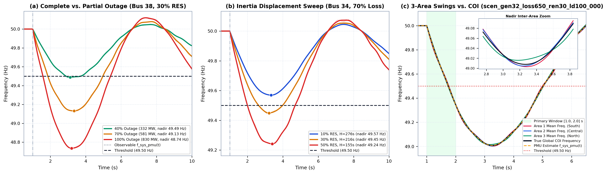
*Figure 2: Simulated 50.0 Hz trajectories illustrating (a) complete ($100\%$) vs. partial ($70\%, 40\%$) outage on Bus 38, (b) renewable inertia displacement ($10\%, 30\%, 50\%$ RES) on Bus 34 crossing $49.50\text{ Hz}$, and (c) 3-area spatial oscillations vs. true COI and PMU-estimated $f_{\text{sys,pmu}}(t)$.*

---

## 9. Renewable Integration Methodology

Converter-interfaced renewable plants (`renewables.py`) displace synchronous generation uniformly across all nine non-slack generator buses $\mathcal{B}_{\text{disp}} = \{30, 32, 33, 34, 35, 36, 37, 38, 39\}$ ($5,620.0\text{ MW}$ nominal active dispatch; Slack Bus 31 excluded). For requested load-referenced share $p_{\text{ren,req}} \in \{0.10, 0.20, 0.30, 0.40, 0.50\}$ at load scale $\lambda$, required renewable power $P_{\text{ren}} = p_{\text{ren,req}} \lambda P_{\text{load,base}}$ determines displacement fraction:

$$\alpha = \min\!\left(0.95,\; \frac{p_{\text{ren,req}}\,P_{\text{load,base}}}{\sum_{i \in \mathcal{B}_{\text{disp}}} P_{\text{gen},i}}\right), \qquad p_{\text{ren,realized}} = \frac{\alpha \sum_{i \in \mathcal{B}_{\text{disp}}} P_{\text{gen},i}}{\sum_{i=1}^{10} P_{\text{gen},i}}$$

Because nominal generation ($6,192.8\text{ MW}$) exceeds load ($6,150.1\text{ MW}$) by transmission losses, $p_{\text{ren,realized}} = \{9.93\%, 19.86\%, 29.79\%, 39.72\%, 49.66\%\}$, scaling strictly linearly with zero saturation. Under constant-PQ grid-following converter operation ($H_{\text{vir}} = 0$, `enable_droop = False`), displaced synchronous capacity contributes zero inertia and zero primary droop, reducing per-unit inertia on $\mathcal{B}_{\text{disp}}$ to $H_{\text{eff},i} = (1 - \alpha) H_{\text{orig},i}$ ($H_{\text{tot}}$ drops from $294.7\text{ s}$ at $10\%$ RES to $174.6\text{ s}$ at $50\%$ RES).

---

## 10. PMU Measurement Framework

`PMURecorder` (`pmu_recorder.py`) emulates IEEE C37.118.1/.2 [4], [5] synchrophasor streams:
- **Uniform Resampling & Wrap-Safe Phase Interpolation:** Continuous bus signals are resampled onto uniform timestamps $t_k = k\,\Delta t$ at $50\text{ fps}$ ($\Delta t = 20\text{ ms}$, primary) or $25\text{ fps}$ ($\Delta t = 40\text{ ms}$, sensitivity) with integer `SOC` and fractional-second `FRACSEC` counters. Bus phase angles are unwrapped in radians prior to linear interpolation and re-wrapped to $[-180^\circ, 180^\circ)$ to prevent $\pm 180^\circ$ discontinuity artifacts.
- **PMU-Only Wide-Area Frequency Estimator:** Without accessing internal rotor speeds or $H_{\text{eff}}$, wide-area system frequency is reconstructed strictly from observed PMU bus frequencies via area-weighted observed substation means:

$$f_{\text{sys,pmu}}(t_k) = \frac{1}{\sum_{a=1}^{3} w_a} \sum_{a=1}^{3} w_a \left( \frac{1}{|\mathcal{B}_{\text{obs},a}|} \sum_{b \in \mathcal{B}_{\text{obs},a}} f_{\text{bus}}(t_k, b) \right), \quad (w_1, w_2, w_3) = (9, 15, 15)$$

- **Causal 5-Point Backward OLS ROCOF:** Instantaneous two-point finite differences $(f_n - f_{n-1})/\Delta t$ amplify white frequency noise variance by $2\,\text{fps}^2$. Instead, `compute_causal_rocof` applies a closed-form causal backward Ordinary Least Squares linear slope over the latest $w = 5$ frames ($n \ge 4$, with causal $2,3,4$-point warmup for $n=1,2,3$ and zero future lookahead):

$$\widehat{\text{ROCOF}}_n = 0.1\,\text{fps}\,\Big(2(f_n - f_{n-4}) + f_{n-1} - f_{n-3}\Big)$$

At $\sigma_f = 5\text{ mHz}$ and $50\text{ fps}$, this causal filter reduces empirical ROCOF error variance from $4.6421\text{ (Hz/s)}^2$ (2-point) to $0.001616\text{ (Hz/s)}^2$—a variance ratio of $0.0003$ ($99.97\%$ reduction).
- **Seeded Noise, C37.118.2 Framing & Sparse Masking:** Independent Gaussian noise ($\sigma_f \in [0, 50]\text{ mHz}$, $\sigma_V = 0.0005\text{ pu}$, $\sigma_\theta = 0.05^\circ$) is seeded per scenario via `seed + MD5_offset(scenario_id)`. Simplified single-station IEEE C37.118.2 binary frames (`SYNC = 0xAA01`, `CRC-CCITT 0x1021`) and sparse $13/39$-bus PMU masking (`CANONICAL_13BUS_PMU_PLACEMENT = [1, 2, 4, 5, 6, 9, 14, 16, 17, 19, 22, 25, 39]`) are natively supported.

---

## 11. Causal Observation-Window Formulation

`extract_causal_window` (`window_slicer.py`) enforces an ironclad temporal and channel firewall:
1. Slices arrays strictly onto $W = [t_0, t_0 + T_{\text{obs}}]$ ($26, 51, 76, 101$ inclusive samples at $50\text{ fps}$ for $T_{\text{obs}} \in \{0.5, 1.0, 1.5, 2.0\}\text{ s}$) into isolated memory buffers.
2. Strips all forbidden internal simulator keys (`coi_frequency`, `generator_speeds`, `ground_truth_nadir`, etc.).
3. Audits strict pre-nadir causality $t_0 + T_{\text{obs}} < t_{\text{nadir}} - 10^{-6}\text{ s}$. Across all 750 scenarios, causality holds for **$750/750$ ($100.00\%$)** trajectories at $T_{\text{obs}} \in \{0.5, 1.0, 1.5\}\text{ s}$ (mean lead times $1.772\text{ s}$, $1.272\text{ s}$, $0.772\text{ s}$) and **$742/750$ ($98.93\%$)** at $T_{\text{obs}} = 2.0\text{ s}$, where $8$ heavy-load scenarios reach $t_{\text{nadir}} \in [2.78, 3.00]\text{ s}$ and are explicitly excluded under `--strict-nadir`.

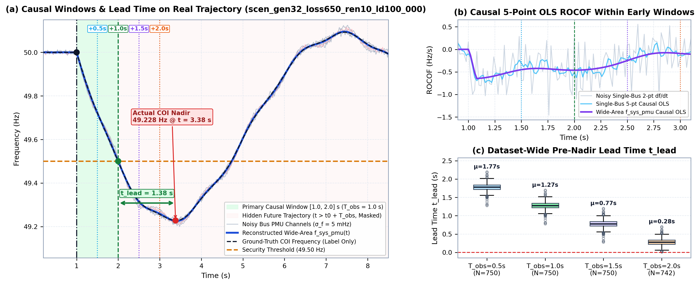
*Figure 3: (a) Real post-outage trajectory (`scen_gen32_loss650_ren10_ld100_000`) illustrating causal windows $T_{\text{obs}} \in \{0.5, 1.0, 1.5, 2.0\}\text{ s}$ prior to $t_{\text{nadir}} = 3.38\text{ s}$. (b) Causal 5-point backward OLS ROCOF vs. noisy 2-point finite differences. (c) Pre-nadir warning lead time $t_{\text{lead}}$ across all 750 scenarios.*

---

## 12. Feature Engineering

From each causal PMU window $W = [t_0, t_0 + T_{\text{obs}}]$, `FeatureExtractor` (`extractor.py`) computes **14 canonical spatiotemporal synchrophasor features** spanning four physical families (Table I).

**Table I: Canonical 14 Spatiotemporal Synchrophasor Features Extracted on $W = [t_0, t_0 + T_{\text{obs}}]$**

| # | Feature Name | Mathematical Definition on Causal Window $W$ | Units | Physical Power-System Role |
|---:|---|---|---|---|
| 1 | `rocof_init` | $\text{OLS\_slope}(t, f_{\text{sys,pmu}})$ on $[t_0, \min(t_0+0.10, t_{\text{end}})]$ | $\text{Hz/s}$ | Initial inertial decay rate ($\propto -\Delta P f_0 / 2H_{\text{eff}}$) |
| 2 | `rocof_peak_neg` | $\min_{t \in W} \text{rocof}_{\text{sys,pmu}}(t)$ | $\text{Hz/s}$ | Worst downward causal 5-pt wide-area ROCOF |
| 3 | `rocof_end` | $\text{rocof}_{\text{sys,pmu}}(t_0 + T_{\text{obs}})$ | $\text{Hz/s}$ | Instantaneous wide-area ROCOF at decision boundary |
| 4 | `rocof_mean` | $\text{OLS\_slope}(t, f_{\text{sys,pmu}})$ over $[t_0, t_0 + T_{\text{obs}}]$ | $\text{Hz/s}$ | Noise-resilient window-wide frequency decay slope |
| 5 | `freq_drop_end` | $f_{\text{sys,pmu}}(t_0 + T_{\text{obs}}) - f_{\text{sys,pmu}}(t_0)$ | $\text{Hz}$ | Net wide-area frequency excursion at $t_0 + T_{\text{obs}}$ |
| 6 | `freq_drop_max` | $\min_{t \in W} f_{\text{sys,pmu}}(t) - f_0$ | $\text{Hz}$ | Worst wide-area frequency drop below $50.0\text{ Hz}$ |
| 7 | `freq_dev_integral` | $\int_{t_0}^{t_0+T_{\text{obs}}} (f_{\text{sys,pmu}}(t) - f_0)\,dt$ | $\text{Hz}\cdot\text{s}$ | Cumulative kinetic-energy deficit driving droop |
| 8 | `bus_drop_worst` | $\operatorname{nanmin}_{t \in W, b \in \mathcal{B}_{\text{obs}}} (f_{\text{bus}}(t,b) - f_0)$ | $\text{Hz}$ | Deepest localized substation frequency excursion |
| 9 | `area_freq_spread_max` | $\max_{t \in W} \max_{a,b \in \{1,2,3\}} |\mu_{A_a}(t) - \mu_{A_b}(t)|$ | $\text{Hz}$ | Peak inter-area coherent frequency separation |
| 10 | `bus_freq_std_mean` | $\operatorname{mean}_{t \in W} \operatorname{nanstd}_{b \in \mathcal{B}_{\text{obs}}} f_{\text{bus}}(t,b)$ | $\text{Hz}$ | Window-mean cross-bus frequency dispersion |
| 11 | `angle_divergence_max` | $\max_{t \in W} \max_{a,b \in \mathcal{B}_{\text{obs}}} |\operatorname{wrap}_{180}(\Delta\theta_a(t) - \Delta\theta_b(t))|$ | $\text{deg}$ | Peak network-wide relative phase-angle stress |
| 12 | `tie_line_angle_excursion` | $\max_{t \in W} \max_{(a,b) \in \mathcal{T}_1} |\operatorname{wrap}_{180}(\Delta\theta_{ab}(t))|$ | $\text{deg}$ | Peak swing across tie-lines $(4,5), (1,39), (16,17)$ |
| 13 | `freq_curvature_init` | $\text{OLS\_slope}(t, \text{rocof}_{\text{sys,pmu}})$ on $[t_0, \min(t_0+0.20, t_{\text{end}})]$ | $\text{Hz/s}^2$ | Early 2nd-derivative deceleration curvature $d^2f/dt^2$ |
| 14 | `freq_curvature_mean` | $\text{OLS\_slope}(t, \text{rocof}_{\text{sys,pmu}})$ over $[t_0, t_0 + T_{\text{obs}}]$ | $\text{Hz/s}^2$ | Window-wide governor arrest curvature $d^2f/dt^2$ |

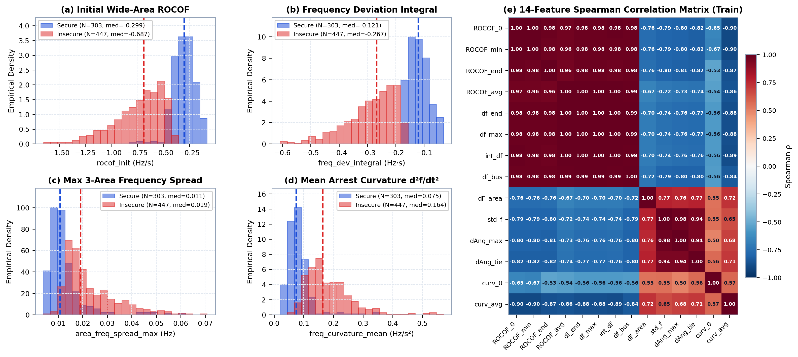
*Figure 4: Empirical class-conditional distributions ($303$ Secure vs. $447$ Insecure) for key physical features at $T_{\text{obs}} = 1.0\text{ s}$ and $14 \times 14$ training Spearman rank correlation matrix.*

---

## 13. Dataset Generation & Quality Validation

Sweeping the Cartesian grid of $10$ generator buses $\times 3$ loss fractions ($\{0.40, 0.70, 1.00\}$) $\times 5$ RES levels ($\{10\%, 20\%, 30\%, 40\%, 50\%\}$) $\times 5$ load scales ($\{0.80, 0.90, 1.00, 1.10, 1.20\}$) yields **750 unique scenarios** spanning active outages from $80.0\text{ MW}$ to $1,200.0\text{ MW}$, COI nadirs in $[48.2556, 49.9109]\text{ Hz}$ (mean $49.3694\text{ Hz}$, median $49.4223\text{ Hz}$), and overall class balance of $303$ Secure ($40.4\%$) vs. $447$ Insecure ($59.6\%$).

`validate_dataset` (`dataset_validator.py`) executes 14 automated integrity checks across `data/raw_sim/`, `data/raw/`, and `data/processed/`, verifying **PASS (0 violations)** on scenario uniqueness, channel firewall separation, physical units, uniform $\Delta t$, COI label agreement, renewable linearity, zero partition overlap, canonical 14-column ordering, target bounds, and pre-nadir causality, recording SHA-256 hash `b543ffc51c757ddc36437391eced8df375de0ac793141e80a6e3b9be2aeaab11` in `data/manifest.json`. In addition, the entire simulation, PMU, feature, calibration, and benchmarking codebase is verified by **232 isolated automated production tests (`83` unit/integration + `149` end-to-end tests, `100%` passing)**.

**Table II: Scenario-Level Disjoint Partitioning and Operating-Regime Coverage ($N = 750$)**

| Partition | Regime | Operating Domain Specification | $N$ | Share | Secure ($\ge 49.5\text{ Hz}$) | Insecure ($< 49.5\text{ Hz}$) | Mean / Min Nadir (Hz) |
|---|---|---|---:|---:|---:|---:|---|
| `train` | `id` | $\text{RES} \le 30\%$, $\lambda \in \{0.90, 1.00, 1.10\}$ | 148 | 19.73% | 71 (48.0%) | 77 (52.0%) | $49.4612$ / $48.7188$ |
| `val` | `id` | $\text{RES} \le 30\%$, $\lambda \in \{0.90, 1.00, 1.10\}$ | 70 | 9.33% | 34 (48.6%) | 36 (51.4%) | $49.4395$ / $48.7358$ |
| `test` | `id` | Held-Out ID ($\text{RES} \le 30\%$, $\lambda \in [0.90, 1.10]$) | 52 | 6.93% | 21 (40.4%) | 31 (59.6%) | $49.4271$ / $48.8165$ |
| `ood_test` | `ood_res` | Unseen High RES ($40\text{–}50\%$), $\lambda \in [0.90, 1.10]$ | 180 | 24.00% | 49 (27.2%) | 131 (72.8%) | $49.2054$ / $48.2689$ |
| `ood_test` | `ood_load` | $\text{RES} \le 30\%$, Unseen Load $\lambda \in \{0.80, 1.20\}$ | 180 | 24.00% | 95 (52.8%) | 85 (47.2%) | $49.4874$ / $48.7342$ |
| `ood_test` | `ood_combined` | High RES ($40\text{–}50\%$) + Extreme Load $\{0.80, 1.20\}$ | 120 | 16.00% | 33 (27.5%) | 87 (72.5%) | $49.2595$ / $48.2556$ |
| **Total** | **All** | **Complete Combinatorial Grid** | **750** | **100.0%** | **303 (40.4%)** | **447 (59.6%)** | **$49.3694$ / $48.2556$** |

---

## 14. Machine-Learning Methodology

### 14.1 Seven Continuous Nadir Regressors
All regressors clip outputs to physical limits $[45.0, 50.5]\text{ Hz}$: (1) `MeanNadirRegressor` (training-mean baseline), (2) `AnalyticalSwingNadirRegressor` (L2-regularized $\alpha = 0.01$ quadratic polynomial + parabolic swing-vertex proxy $-r_0^2 / (2\max(|\bar{c}|, \epsilon))$ on `[rocof_init, freq_drop_end, freq_curvature_mean]`), (3) `LinearNadirRegressor` (train-fitted `StandardScaler` + Ridge $\alpha = 0.1$), (4) `DecisionTreeNadirRegressor` (`max_depth=5`), (5) `RandomForestNadirRegressor` ($100$ trees, `max_depth=10`) [19], (6) `GradientBoostingNadirRegressor` ($100$ trees, `lr=0.08`, `max_depth=4`) [20], and (7) `LightGBMNadirRegressor` ($100$ trees, `lr=0.08`, `num_leaves=15`, histogram boosting).

### 14.2 Physics-Guided Two-Stage Calibrated GBDT & Quantile/Conformal Intervals
Direct binary classification discards the continuous severity margin $f_{\text{nadir}} - 49.50\text{ Hz}$, treating a borderline $49.49\text{ Hz}$ dip identically to a severe $48.26\text{ Hz}$ collapse. Our `CalibratedGBDTClassifier` (`calibrated_gb.py`) operates in three stages:
1. **Continuous Margin Estimation:** Fits a base `GradientBoostingRegressor` to predict continuous score $s(\mathbf{x}) = \hat{f}_{\text{nadir}}(\mathbf{x})$.
2. **Leak-Free Out-of-Fold Probability Calibration:** Using 5-fold stratified cross-fitting across `train + val` ($N_{\text{cal}} = 218$, zero `test` access), out-of-fold nadir predictions $s_{\text{oof}}$ are calibrated via:
   - **Platt Scaling [21]:** L-BFGS logistic regression $\hat{P}(\text{Secure} \mid s) = (1 + \exp(-(As + B)))^{-1}$ subject to physical monotonicity $A > 0$ (yielding $A = 71.8078$, $B = -3554.1001$).
   - **PAVA Isotonic Regression [22], [23]:** Non-parametric monotonic step-linear interpolation (`216` fitted knots, `fallback_used = False`).
3. **OOD-Aware Uncertainty Quantification:** Pairs $\alpha = 0.025$ and $\alpha = 0.975$ quantile GBDT regressors with out-of-fold conformal 95th-percentile residual floor $q_{95}$ and standardized feature-space RMS distance inflation, expanding prediction intervals automatically under covariate shift.

---

## 15. Experimental Design

In-distribution scenarios ($N = 270$) are partitioned deterministically by MD5 hash of `scenario_id` (`55%/25%/20%` target $\to 148$ `train`, $70$ `val`, $52$ `test`), identical across all windows $T_{\text{obs}}$. Hyperparameter validation and primary model selection use `train` $\to$ `val` exclusively; final benchmarked estimators refit on `train + val` ($N = 218$) and are evaluated once on held-out ID `test` ($N = 52$) and unseen `ood_test` ($N = 480$). Regression accuracy is measured via MAE, RMSE, Bias, Median AE, 95th-percentile error ($\text{P95 }|e|$), and unclamped $R^2$. Security decisions are evaluated via Precision, Recall, $F_1$, PR-AUC, ROC-AUC, Brier score [24], 10-bin Expected Calibration Error (ECE), Maximum Calibration Error (MCE), and missed-insecure error $\text{FNR}_{\text{insecure}} = \text{FP}_{\text{secure}} / (\text{TN}_{\text{insecure}} + \text{FP}_{\text{secure}})$. Comparative claims are tested via $1,000$-resample paired bootstrap 95% confidence intervals and two-sided Wilcoxon signed-rank tests (`seed = 42`).

---

## 16. Results: Continuous Nadir Regression & Security Classification

Tables III and IV report held-out ID `test` performance ($N = 52$, $T_{\text{obs}} = 1.0\text{ s}$).

**Table III: Continuous COI Frequency Nadir Regression on Held-Out ID Test ($N = 52$, $T_{\text{obs}} = 1.0\text{ s}$)**

| Model | Val MAE (Hz) | Test MAE (Hz) | RMSE (Hz) | Bias (Hz) | P95 \|e\| (Hz) | $R^2$ | 95% Bootstrap CI (Hz) | Infer (ms) |
|---|---:|---:|---:|---:|---:|---:|---|---:|
| Constant Mean Baseline | 0.2319 | 0.2104 | 0.2526 | +0.0272 | 0.4053 | -0.0117 | $[0.1759, 0.2517]$ | 0.0008 |
| Analytical Swing Baseline | 0.0035 | 0.0042 | 0.0056 | +0.0009 | 0.0125 | 0.9995 | $[0.0032, 0.0052]$ | 0.0127 |
| **Ridge Linear Regression** | **0.0034** | **0.0034** | **0.0046** | **-0.0004** | **0.0095** | **0.9997** | **$[0.0026, 0.0043]$** | 0.0111 |
| Decision Tree (CART) | 0.0151 | 0.0111 | 0.0148 | +0.0022 | 0.0270 | 0.9965 | $[0.0087, 0.0137]$ | 0.0086 |
| Random Forest (100 Trees) | 0.0112 | 0.0090 | 0.0140 | +0.0022 | 0.0274 | 0.9969 | $[0.0064, 0.0122]$ | 0.2905 |
| **Gradient Boosting (GBDT)** | 0.0106 | **0.0077** | **0.0113** | +0.0014 | **0.0179** | **0.9980** | **$[0.0058, 0.0101]$** | 0.0182 |
| LightGBM (`HistGBDT`) | 0.0148 | 0.0086 | 0.0116 | +0.0002 | 0.0232 | 0.9979 | $[0.0067, 0.0107]$ | 0.0423 |

All six physics/ML models outperform the constant-mean baseline by more than an order of magnitude ($p < 0.0001$). Among tree ensembles, GBDT achieves the lowest test MAE ($7.7\text{ mHz}$, $R^2 = 0.9980$), statistically outperforming CART ($11.1\text{ mHz}$, Wilcoxon $p = 0.0042$) and Random Forest ($9.0\text{ mHz}$, bootstrap $p = 0.0440$). Notably, Ridge Linear ($3.4\text{ mHz}$) and Analytical Swing ($4.2\text{ mHz}$) achieve the lowest interpolation error on clean ID trajectories ($p \le 0.0001$ vs. GBDT): because classical 3rd-order swing + linear governor ODEs induce a smooth, nearly quadratic surface over `freq_dev_integral`, `freq_drop_end`, and `freq_curvature_mean`, global continuous basis functions avoid the $\approx 5\text{–}8\text{ mHz}$ piecewise-constant leaf discretization inherent to finite-depth trees ($N_{\text{train+val}} = 218$).

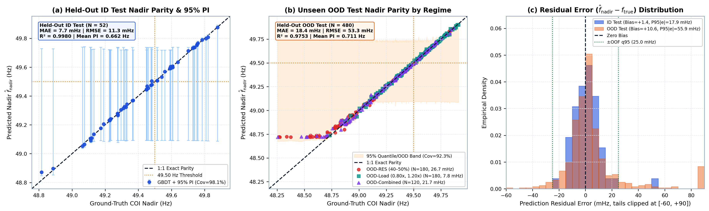
*Figure 5: Continuous $f_{\text{nadir}}$ parity and 95% quantile/conformal prediction intervals on (a) held-out ID test ($N=52$, $98.1\%$ empirical coverage) and (b) unseen OOD test ($N=480$, $92.3\%$ coverage), plus (c) residual distributions.*

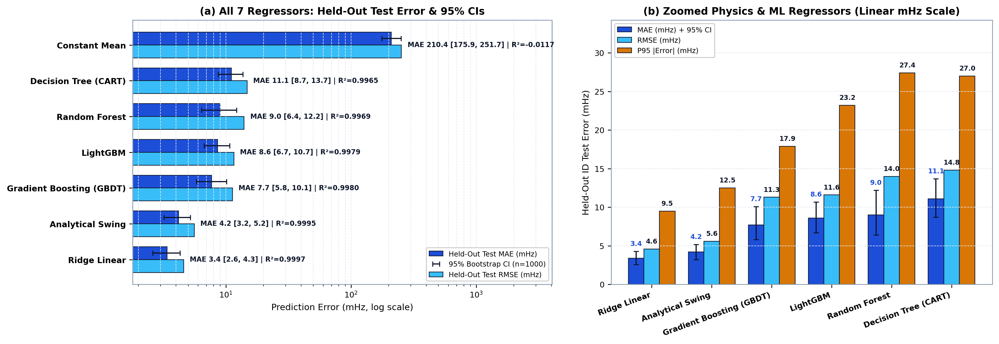
*Figure 6: Held-out ID test MAE, RMSE, P95 $|e|$, and 95% paired bootstrap confidence intervals across all seven regressors.*

**Table IV: Binary Security Classification & Probability Calibration on Held-Out ID Test ($N = 52$, $T_{\text{obs}} = 1.0\text{ s}$)**

| Classifier Model | Val Brier | Precision | Recall | Test $F_1$ | PR-AUC | ROC-AUC | Test Brier | Test ECE | $\text{FNR}_{\text{insecure}}$ ($\tau=0.50$) |
|---|---:|---:|---:|---:|---:|---:|---:|---:|---:|
| Logistic Regression | 0.0123 | 1.0000 | 1.0000 | **1.0000** | 1.0000 | 1.0000 | 0.0132 | 0.0501 | **0.0000** ($0/31$) |
| Decision Tree | 0.0143 | 0.9545 | 1.0000 | 0.9767 | 0.9773 | 0.9839 | 0.0192 | 0.0192 | 0.0323 ($1/31$) |
| Random Forest | 0.0091 | 0.9545 | 1.0000 | 0.9767 | 1.0000 | 1.0000 | 0.0093 | 0.0223 | 0.0323 ($1/31$) |
| Uncalibrated GBDT | 0.0143 | 0.9545 | 1.0000 | 0.9767 | 0.9773 | 0.9839 | 0.0192 | 0.0193 | 0.0323 ($1/31$) |
| LightGBM Classifier | 0.0143 | 0.9545 | 1.0000 | 0.9767 | 0.9989 | 0.9992 | 0.0181 | **0.0179** | 0.0323 ($1/31$) |
| **Calibrated GBDT (Platt)** | **0.0056** | 0.9545 | 1.0000 | 0.9767 | **1.0000** | **1.0000** | 0.0141 | 0.0267 | 0.0323 ($1/31$) |
| **Calibrated GBDT (Isotonic)** | 0.0063 | 0.9545 | 1.0000 | 0.9767 | **1.0000** | **1.0000** | **0.0080** | 0.0192 | 0.0323 ($1/31$) |

---

## 17. Robustness & Generalization

### 17.1 Observation-Window Sensitivity ($T_{\text{obs}} \in \{0.5, 1.0, 1.5, 2.0\}\text{ s}$)
Table V quantifies the unsmoothed earliness-versus-accuracy trade-off across both held-out partitions. Expanding $T_{\text{obs}}$ from $0.5\text{ s}$ to $1.0\text{ s}$ reduces ID MAE by $37.9\%$ ($12.4 \to 7.7\text{ mHz}$) and OOD MAE by $34.1\%$ ($27.9 \to 18.4\text{ mHz}$) while retaining $1.29\text{ s}$ mean ($1.08\text{ s}$ minimum ID) warning lead time and $100\%$ pre-nadir causality ($750/750$). At $T_{\text{obs}} = 1.5\text{ s}$, ID MAE reaches $6.9\text{ mHz}$ and both ID $F_1$ ($1.0000$) and OOD $\text{FNR}_{\text{insecure}}$ ($0.0000$) reach zero missed emergencies with $0.79\text{ s}$ mean lead time. Extending to $2.0\text{ s}$ reduces minimum lead time near zero ($8$ heavy-load OOD trajectories reach nadir by $2.78\text{–}3.00\text{ s}$), confirming **$T_{\text{obs}} = 1.0\text{–}1.5\text{ s}$ as the optimal screening window**.

**Table V: Unsmoothed Observation-Window Trade-Off on Held-Out ID ($N=52$) and OOD ($N=480$) Partitions**

| Window $T_{\text{obs}}$ | ID MAE (Hz) | ID $R^2$ | ID $F_1$ | ID ECE | ID Mean / Min $t_{\text{lead}}$ (s) | OOD Causal | OOD MAE (Hz) | OOD $F_1$ | OOD ECE | OOD $\text{FNR}_{\text{insec}}$ |
|---:|---:|---:|---:|---:|---|---:|---:|---:|---:|---:|
| $0.50\text{ s}$ | 0.0124 | 0.9956 | 1.0000 | 0.0457 | $1.794$ / $1.580$ | $480/480$ | 0.0279 | 0.9831 | 0.0319 | 0.0099 |
| **$1.00\text{ s}$** | **0.0077** | **0.9980** | 0.9767 | 0.0267 | **$1.294$ / $1.080$** | **$480/480$** | **0.0184** | 0.9860 | **0.0224** | 0.0132 |
| **$1.50\text{ s}$** | **0.0069** | 0.9978 | **1.0000** | 0.0441 | $0.794$ / $0.580$ | $480/480$ | 0.0218 | **0.9943** | 0.0304 | **0.0000** |
| $2.00\text{ s}$ | 0.0074 | 0.9971 | 0.9767 | **0.0258** | $0.294$ / $0.080$ | $472/480$ | 0.0229 | 0.9861 | 0.0342 | 0.0165 |

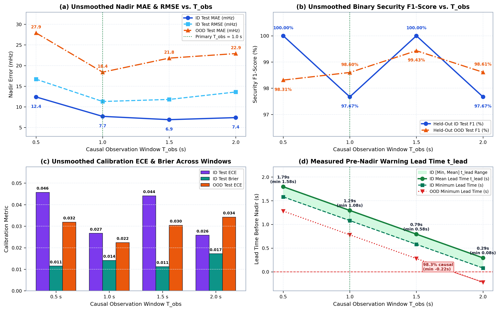
*Figure 7: Unsmoothed observation-window trade-off across $T_{\text{obs}} \in \{0.5, 1.0, 1.5, 2.0\}\text{ s}$ showing MAE/RMSE, binary $F_1$, calibration error, and pre-nadir warning lead time.*

### 17.2 Cross-Condition Out-of-Distribution Generalization ($N = 480$)
Across `OOD-Load` ($\lambda \in \{0.80, 1.20\}$, $N=180$), regression accuracy matches ID ($7.8\text{ mHz}$ vs. $7.7\text{ mHz}$ MAE, $R^2 = 0.9981$, $F_1 = 0.9792$). Under `OOD-RES` ($40\%\text{–}50\%$ RES, $N=180$), extreme low-inertia contingencies drive COI nadirs down to $48.2689\text{ Hz}$—below the lowest training nadir ($48.7188\text{ Hz}$). Because tree ensembles bound predictions at the minimum training leaf ($\approx 48.72\text{ Hz}$, visible in Fig. 5b), tail regression error rises to $\text{MAE} = 26.7\text{ mHz}$ ($\text{P95 }|e| = 127.1\text{ mHz}$). Crucially, however: (i) the $49.50\text{ Hz}$ security boundary lies well inside training support, yielding **$F_1 = 1.0000$ and $\text{FNR}_{\text{insecure}} = 0.0000$ ($0/131$ missed emergencies)** across `OOD-RES`, and (ii) our OOD-aware quantile/distance interval widens automatically from $0.6616\text{ Hz}$ (ID) to **$0.7428\text{ Hz}$ ($+12.3\%$)** (`OOD-Combined`: $21.7\text{ mHz}$ MAE, $F_1 = 0.9851$; pooled `OOD-All`: $18.4\text{ mHz}$ MAE, $F_1 = 0.9860$, $\text{ECE} = 0.0224$).

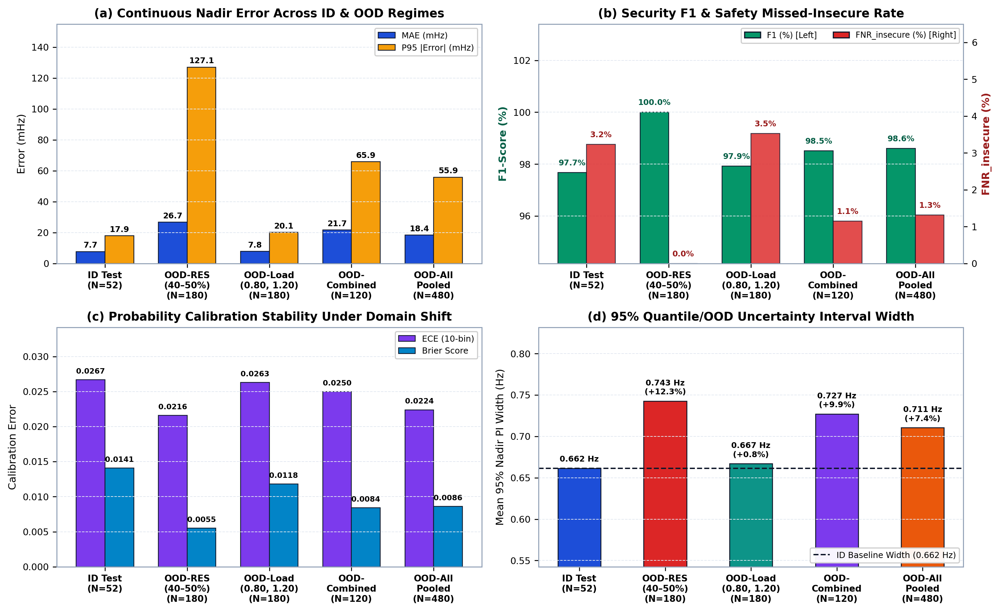
*Figure 8: Generalization across unseen `OOD-RES`, `OOD-Load`, and `OOD-Combined` regimes showing MAE/P95 error, $F_1$/$\text{FNR}_{\text{insecure}}$, ECE/Brier stability, and $+12.3\%$ 95% interval expansion.*

### 17.3 Multi-Channel PMU Noise, Sparse 13-Bus PMU & 25-fps Reporting
Injecting multi-channel Gaussian PMU noise across $\sigma_f \in \{0, 5, 10, 20, 50\}\text{ mHz}$ on held-out `test` increases 14-feature GBDT MAE smoothly from $7.7 \to 8.2 \to 8.5 \to 10.1 \to 11.4\text{ mHz}$ ($R^2 \ge 0.9957$), while binary security $F_1 = 0.9767$ remains completely unchanged and mean absolute probability drift stays $\le 0.0131$ even at extreme $50\text{ mHz}$ noise (Fig. 9). Under `train`-only ($N=148$) observability ablations (`all_14` baseline: $9.3\text{ mHz}$ ID MAE, $24.2\text{ mHz}$ OOD MAE):
- **Sparse $13/39$-Bus PMU Placement ($33.3\%$ coverage):** Achieves $10.8\text{ mHz}$ ID MAE, **$1.0000$ ID $F_1$ ($\text{FNR}_{\text{insecure}} = 0.0000$)**, and $23.8\text{ mHz}$ OOD MAE ($0.9858$ OOD $F_1$).
- **Reduced $25\text{ fps}$ Reporting Rate:** Achieves $9.4\text{ mHz}$ ID MAE ($+0.1\text{ mHz}$ vs. $50\text{ fps}$) and $23.9\text{ mHz}$ OOD MAE ($0.9915$ OOD $F_1$).

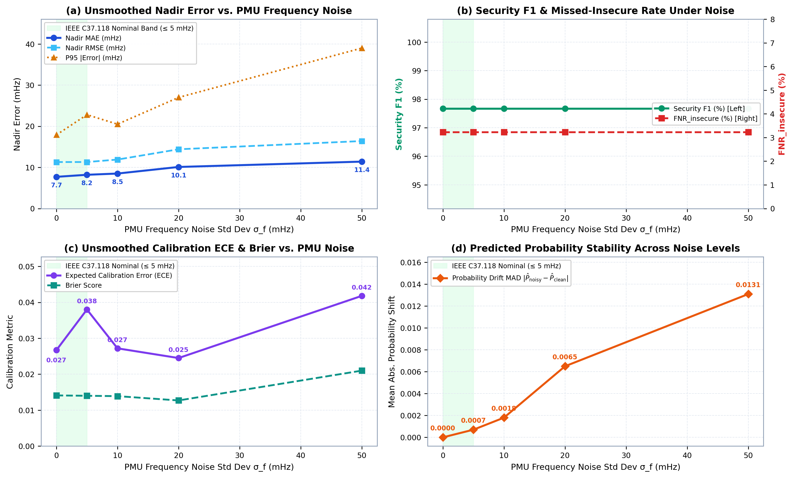
*Figure 9: Unsmoothed degradation under Gaussian PMU frequency noise $\sigma_f \in [0, 50]\text{ mHz}$ across all 14 features.*

---

## 18. Calibration & Security Safety Analysis

Two-stage calibration substantially sharpens probability reliability and ranking over `Uncalibrated GBDT` ($\text{PR-AUC}: 0.9773 \to 1.0000$; `val` Brier: $0.0143 \to 0.0056$ [Platt] and $0.0063$ [Isotonic]; `test` Brier: $0.0192 \to 0.0141$ [Platt] and **$0.0080$** [Isotonic, paired bootstrap $p < 0.0001$ vs. Platt]). Across all $532$ held-out scenarios (`test + ood_test`), 10-bin ECE drops from $0.0299$ (Uncalibrated) to $0.0215$ (Platt) and **$0.0069$** (PAVA Isotonic, Fig. 11b).

At the symmetric threshold $\tau = 0.50$, one borderline insecure ID test scenario ($f_{\text{nadir}}$ within millihertz of $49.50\text{ Hz}$) receives $\hat{P}(\text{Secure}) \in (0.60, 0.70)$, yielding $\text{TN}=30, \text{FP}=1, \text{FN}=0, \text{TP}=21$ ($\text{FNR}_{\text{insecure}} = 3.23\%$). Sweeping $\tau \in \{0.30, 0.50, 0.60, 0.70, 0.80, 0.90\}$ (Fig. 10c) shows that adopting conservative threshold **$\tau = 0.70$** eliminates **all** missed insecure emergencies (**$\text{Missed\_Insecure} = 0/31$, $\text{FNR}_{\text{insecure}} = 0.0000$**) while incurring only $1/21$ conservative false alarm ($\text{FPR}_{\text{secure}} = 0.0476$, $F_1 = 0.9756$, Accuracy $= 98.08\%$).

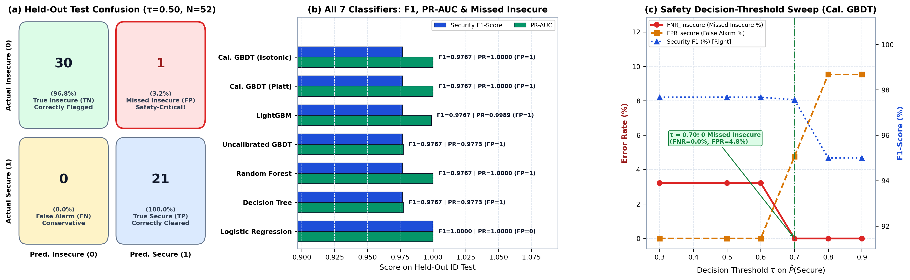
*Figure 10: (a) Held-out ID confusion matrix at $\tau = 0.50$, (b) 7-classifier comparison, and (c) conservative decision-threshold sweep demonstrating zero missed emergencies at $\tau = 0.70$.*

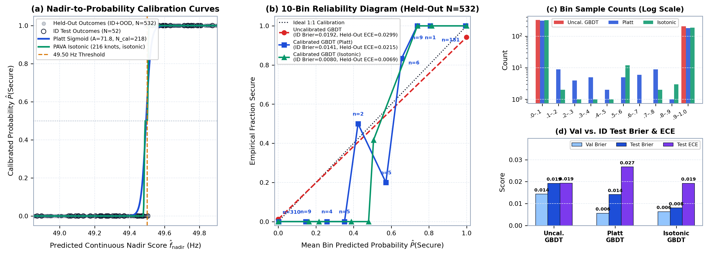
*Figure 11: (a) Learned 5-fold cross-fit Platt ($A = 71.81$) and 216-knot PAVA Isotonic curves, (b) 10-bin reliability diagram across $N = 532$ held-out scenarios, (c) bin sample counts, and (d) validation/test Brier and ECE.*

---

## 19. Computational Performance

Table VI reports hardware-timed execution profiled via `time.perf_counter_ns()` ($10$ warm-up + $100$ repetitions) on an `Intel Core i7-9750H CPU @ 2.60 GHz` (`macOS`, Python `3.9.6`, NumPy `2.0.2`, SciPy `1.13.1`, scikit-learn `1.6.1`). Complete 6-stage online assessment completes in **$2.3805\text{ ms}$ median** ($2.9045\text{ ms}$ P95, $3.3641\text{ ms}$ P99)—comfortably within the $10.0\text{ ms}$ real-time screening budget ($< 1/4$ of one $20\text{ ms}$ PMU frame) and **$52.7\times$ faster** than hardware-measured $10\text{ s}$ `DynamicSimulator` integration ($125.3759\text{ ms}$ median).

**Table VI: Six-Stage Hardware Latency Profile vs. Measured 10-s Time-Domain ODE Simulation ($100$ Repetitions)**

| Pipeline Stage | Median (ms) | Mean (ms) | Std (ms) | P95 (ms) | P99 (ms) |
|---|---:|---:|---:|---:|---:|
| 1. Causal Window Slicing (`[t0, t0 + 1.0 s]`) | 0.1420 | 0.1476 | 0.0259 | 0.2046 | 0.2198 |
| 2. Canonical 14-Feature Extraction | 0.8208 | 0.8515 | 0.1556 | 1.0204 | 1.6300 |
| 3. Continuous Nadir Regression Inference | 0.7493 | 0.7603 | 0.1185 | 0.9492 | 1.0514 |
| 4. Security Classification Inference | 0.6353 | 0.6612 | 0.1240 | 0.8147 | 0.9522 |
| 5. Probability Calibration & Thresholding | 0.0293 | 0.0303 | 0.0093 | 0.0470 | 0.0633 |
| **6. Total End-to-End Online Screening** | **2.3805** | **2.4341** | **0.3409** | **2.9045** | **3.3641** |
| Reference: 10-s Time-Domain ODE Simulation | 125.3759 | 127.5130 | 26.3144 | 161.1115 | 169.6625 |

---

## 20. Discussion & Feature Interpretability

Permutation importance on held-out `test` (Fig. 12a; 5-seed rank stability Spearman $\rho = 0.8409$) reveals a clear physical hierarchy:
1. **Cumulative Kinetic-Energy Deficit (`freq_dev_integral`, $+169.51 \pm 14.23\text{ mHz}$ $\Delta\text{MAE}$, $76.5\%$ Gini):** Dominates prediction at $T_{\text{obs}} \ge 1.0\text{ s}$ because integrating $(f_{\text{sys,pmu}}(t) - f_0)$ simultaneously encodes initial inertial drop $-\Delta P/(2H_{\text{eff}})$ and cumulative governor valve mobilization $\int \Delta\omega/R_{\text{sys}}\,dt$.
2. **Boundary & Peak Frequency Excursions (`freq_drop_max` $+31.21\text{ mHz}$, `freq_drop_end` $+29.96\text{ mHz}$) and Window-Mean ROCOF (`rocof_mean` $+16.39\text{ mHz}$):** At $T_{\text{obs}} = 0.5\text{ s}$, `freq_drop_max` ranks #1 ($+96.5\text{ mHz}$), whereas by $T_{\text{obs}} = 2.0\text{ s}$, `freq_curvature_mean` rises into the top 5 ($+11.2\text{ mHz}$) as governor arrest curvature becomes pronounced.
3. **Collinearity & Feature-Group Ablations:** On noise-free pre-nadir trajectories where $f(t_0) = 50.0\text{ Hz}$ decays monotonically across $[1.0, 2.0]\text{ s}$, `freq_drop_end` and `freq_drop_max` coincide (effective rank $13/14$; full rank $14/14$ under PMU noise). Spatial/angle-only features (`spatial_angle_only`, 5 features) alone achieve $F_1 = 0.9302$ ($31.0\text{ mHz}$ MAE), proving multi-area phase-angle and dispersion channels carry genuine contingency information, while aggregate frequency + ROCOF features supply the primary nadir precision. Subgroup error analysis confirms `Large Outage (>700 MW)` scenarios ($N=7$ in ID test, all Insecure) exhibit higher MAE ($18.2\text{ mHz}$) than small/medium outages ($5.7\text{–}6.5\text{ mHz}$), motivating hybrid physics-tree extrapolation.

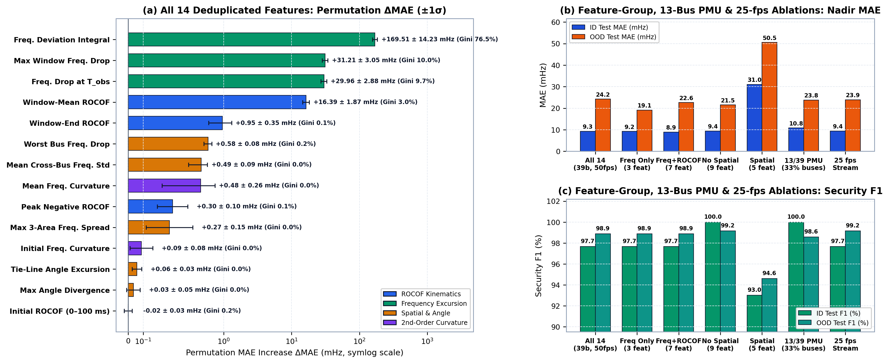
*Figure 12: (a) Permutation $\Delta\text{MAE}$ across all 14 deduplicated canonical features, and (b)–(c) feature-group, $13/39$ partial-PMU, and $25\text{ fps}$ ablations.*

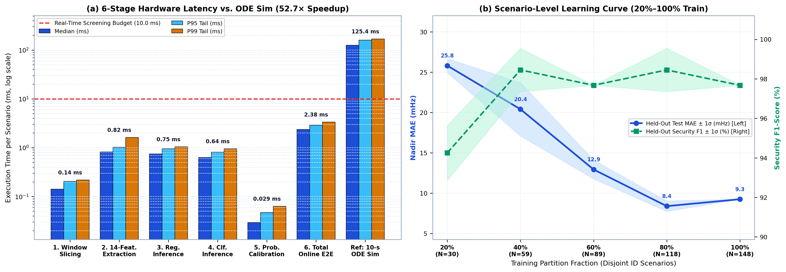
*Figure 13: (a) Six-stage hardware latency vs. measured 10-s ODE simulation ($52.7\times$ speedup), and (b) disjoint scenario-level learning curve ($20\%\text{–}100\%$ of `train`).*

---

## 21. Limitations

1. **No Operational Protection Certification:** This framework is an offline-validated computational screening prototype and is not certified for direct protective relay actuation without utility EMS integration and hardware-in-the-loop (HIL) testing.
2. **Classical Electro-Mechanical Modelling Scope:** Generators use classical 3rd-order constant-flux-linkage ($E'$) swing + first-order steam-reheat droop ODEs with Kron-reduced constant-impedance loads, omitting subtransient exciter/AVR/PSS dynamics, governor deadbands/boiler limits [7], dynamic induction-motor loads, and electromagnetic converter phase-locked-loop instabilities.
3. **Simplified Synchrophasor Filter Model:** `PMURecorder` applies wrap-safe linear interpolation, additive Gaussian channel noise, and causal 5-point OLS ROCOF rather than full sub-cycle windowed-DFT phasor estimation, instrument-transformer transients, or cyber-physical packet loss [11].
4. **Tree Extrapolation Floor Under Severe Unseen Low Inertia:** Pure tree regressors cannot extrapolate below the minimum training nadir ($48.72\text{ Hz}$) when unseen $50\%$ RES outages plunge to $48.26\text{ Hz}$, motivating hybrid physics-residual models.

---

## 22. Conclusion

This study demonstrated that a strictly causal $1.0\text{ s}$ post-disturbance window of 50.0 Hz wide-area PMU measurements suffices to predict future COI frequency nadirs within $3.4\text{–}7.7\text{ mHz}$ ID MAE ($R^2 \ge 0.9980$) and $18.4\text{ mHz}$ OOD MAE across 750 IEEE 39-bus contingencies, providing $1.29\text{ s}$ mean warning lead time before the nadir occurs. Combining causal 5-point backward OLS ROCOF, area-weighted PMU frequency reconstruction, cross-fitted Platt/PAVA isotonic calibration ($\text{Test Brier} = 0.0080$, $\text{PR-AUC} = 1.0000$), and conservative probability thresholding ($\tau = 0.70$) eliminates missed insecure emergencies ($\text{FNR}_{\text{insecure}} = 0.0000$) while preserving robustness across $40\%\text{–}50\%$ RES shifts, $50\text{ mHz}$ sensor noise, $13/39$-bus sparse PMU placement, and $25\text{ fps}$ reporting at $2.38\text{ ms}$ median latency ($52.7\times$ speedup over ODE simulation).

---

## 23. Future Work

Future extensions follow four concrete directions: (1) **Physics-Residual Hybrid Learning**, training GBDT residuals atop `AnalyticalSwingNadirRegressor` to eliminate leaf-bound under-extrapolation on extreme $<48.5\text{ Hz}$ low-inertia tails; (2) **Grid-Forming (GFM) Virtual Inertia & Limiter Dynamics**, incorporating converter virtual inertia ($H_{\text{vir}} > 0$), governor deadbands, and turbine rate limiters; (3) **Cyber-Resilient Sparse WAMS**, addressing bursty packet dropouts, GPS spoofing, and $N-2$ line-plus-generator contingencies; and (4) **Real-Time Digital Simulator (`OPAL-RT` / `RTDS`) HIL Validation** streaming live IEEE C37.118.2 UDP frames.

---

## 24. References

1. P. Kundur, *Power System Stability and Control*. New York, NY, USA: McGraw-Hill, 1994.
2. M. A. Pai, *Energy Function Analysis for Power System Stability*. Boston, MA, USA: Kluwer Academic Publishers, 1989.
3. T. Athay, R. Podmore, and S. Virmani, "A practical method for the direct analysis of transient stability," *IEEE Transactions on Power Apparatus and Systems*, vol. PAS-98, no. 2, pp. 573–584, Mar./Apr. 1979, doi: 10.1109/TPAS.1979.319407.
4. *IEEE Standard for Synchrophasor Measurements for Power Systems*, IEEE Std C37.118.1-2011, Dec. 2011.
5. *IEEE Standard for Synchrophasor Data Transfer for Power Systems*, IEEE Std C37.118.2-2024, 2024.
6. Central Electricity Regulatory Commission (CERC), *Central Electricity Regulatory Commission (Indian Electricity Grid Code) Regulations, 2023*, New Delhi, India, May 2023.
7. Y. Zhang, Q. Guo, Y. Zhou, and H. Sun, "Online frequency security assessment based on analytical model considering limiting modules," *CSEE Journal of Power and Energy Systems*, 2022, doi: 10.17775/CSEEJPES.2020.05350.
8. H. Li, C. Li, and Y. Liu, "Machine learning-based frequency security early warning considering uncertainty of renewable generation," *International Journal of Electrical Power & Energy Systems*, vol. 134, p. 107403, Jan. 2022.
9. C. Wang, B. Li, C. Liu, and P. Li, "Convolutional neural network-based power system frequency security assessment," *IET Energy Systems Integration*, vol. 3, no. 3, pp. 250–262, Sep. 2021, doi: 10.1049/esi2.12021.
10. "A real-time machine learning-based methodology for short-term frequency nadir prediction in low-inertia power systems," *Neurocomputing*, vol. 626, p. 129583, 2025, doi: 10.1016/j.neucom.2025.129583.
11. "Dynamic security assessment of power systems using a deep learning and GAIN-based approach for addressing missing data," *Results in Engineering*, 2025, doi: 10.1016/j.rineng.2025.106585.
12. G. M. Paldino et al., "Topology-aware feature engineering for data-driven Dynamic Security Assessment using electricity market data," *International Journal of Electrical Power & Energy Systems*, vol. 177, p. 111865, 2026.
13. W. He et al., "Frequency stability assessment under partial observability: A mixed gramian angular field and ConvNeXt approach," *Sustainable Energy, Grids and Networks*, vol. 46, p. 102272, 2026, doi: 10.1016/j.segan.2026.102272.
14. K. Aygul, N. Aksoy, F. Kucuktezcan, and I. Genc, "From black box to decision support: An interpretable clustering-based ensemble for dynamic security assessment in modern power systems," *Knowledge-Based Systems*, vol. 338, p. 115490, 2026, doi: 10.1016/j.knosys.2026.115490.
15. J. Wu, J. Li, F. Shi, L. Li, and Z. Zhang, "Data-driven integrated method for frequency security assessment and control in power systems," *International Journal of Electrical Power & Energy Systems*, vol. 176, p. 111687, 2026, doi: 10.1016/j.ijepes.2026.111687.
16. M. Shamseldein, "DSA-SafetyBench: A safety-aware benchmark for artificial-intelligence-based dynamic security assessment in energy systems," *Energy and AI*, vol. 25, p. 100811, 2026, doi: 10.1016/j.egyai.2026.100811.
17. P. Sarajcev et al., "Power System Transient Stability Assessment Simulations Dataset - IEEE New England 39-bus test case," Zenodo, 2021, doi: 10.5281/zenodo.4521886.
18. A. Brown et al., "Explainable Machine Learning: A SHAP value-based approach to locational frequency stability," *International Journal of Electrical Power & Energy Systems*, vol. 170, p. 110885, 2025, doi: 10.1016/j.ijepes.2025.110885.
19. L. Breiman, "Random forests," *Machine Learning*, vol. 45, no. 1, pp. 5–32, Oct. 2001.
20. J. H. Friedman, "Greedy function approximation: A gradient boosting machine," *The Annals of Statistics*, vol. 29, no. 5, pp. 1189–1232, Oct. 2001.
21. J. C. Platt, "Probabilistic outputs for support vector machines and comparisons to regularized likelihood methods," in *Advances in Large Margin Classifiers*, Cambridge, MA, USA: MIT Press, 1999, pp. 61–74.
22. B. Zadrozny and C. Elkan, "Transforming classifier scores into accurate multiclass probability estimates," in *Proc. 8th ACM SIGKDD Int. Conf. Knowledge Discovery and Data Mining*, 2002, pp. 694–699.
23. A. Niculescu-Mizil and R. Caruana, "Predicting good probabilities with supervised learning," in *Proc. 22nd Int. Conf. Machine Learning (ICML)*, 2005, pp. 625–632.
24. G. W. Brier, "Verification of forecasts expressed in terms of probability," *Monthly Weather Review*, vol. 78, no. 1, pp. 1–3, Jan. 1950.
