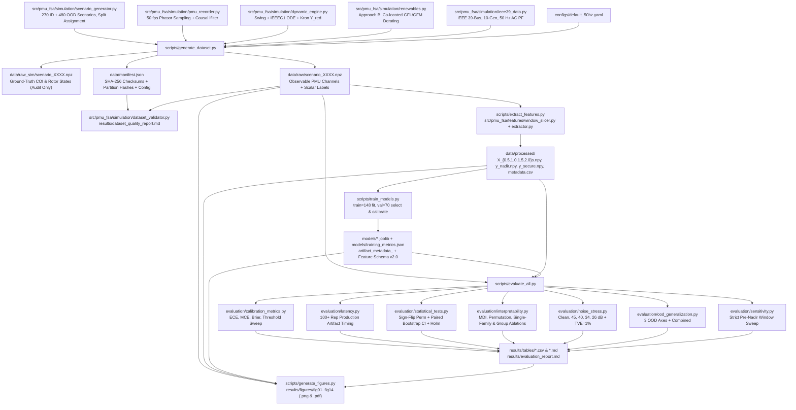

# Phase 1 — Dependency and End-to-End Dataflow Map

## 1. End-to-End Pipeline Architecture

---

## 2. Causal Firewall & Partition Isolation Boundaries

| Boundary | Allowed Inputs | Strictly Forbidden Inputs | Enforcement Mechanism |
| :--- | :--- | :--- | :--- |
| **PMU Feature Extraction (`extractor.py`)** | `t`, `bus_frequencies`, `bus_rocof`, `voltage_magnitudes`, `voltage_angles`, `pmu_sys_frequency` within $[t_0, t_0 + T_{\mathrm{obs}}]$ | `coi_frequency`, `rotor_angles`, `rotor_speeds`, `mech_powers`, `h_eff`, `p_lost_mw`, `ren_penetration`, samples at $t > t_0 + T_{\mathrm{obs}}$ | Hard check on `bus_frequencies` & `voltage_angles` presence; zero fallback to `coi_frequency`; `WindowSlicer` truncates at $t_0 + T_{\mathrm{obs}}$. |
| **Strict Pre-Nadir Gate (`strict_nadir=True`)** | Scenarios satisfying $t_0 + T_{\mathrm{obs}} < t_{\mathrm{nadir}}$ (`lead_time > 0`) | Any scenario where $t_{\mathrm{nadir}} \le t_0 + T_{\mathrm{obs}}$ (e.g., 8 OOD cases at $T_{\mathrm{obs}} = 2.0\text{ s}$) | Enforced identically in `extract_features.py`, `WindowSensitivityBenchmark`, `OODGeneralizationEvaluator`, `NoiseStressTest`, and `InterpretabilityAnalyzer`. |
| **Model Fitting (`train_models.py`)** | `split == "train"` (`148` ID scenarios) | `val` (`70`), `test` (`52`), `ood_test` (`480`) | Scenario-level partition mask verified by `DatasetValidator` and `partition_scenario_hashes`. |
| **Model Selection & Calibration (`train_models.py`, `calibrated_gb.py`)** | `split == "val"` (`70` ID scenarios) | `test` (`52`), `ood_test` (`480`) | Validation MAE selects `best_regressor` (`linear` Ridge); validation Brier selects `calibrated_gb` (`Platt`); calibrator sigmoid/isotonic map fit strictly on `val`. |
| **Held-Out & OOD Reporting (`evaluate_all.py`)** | `split == "test"` (`52` ID) and `split == "ood_test"` (`480` OOD; `472` at `2.0 s`) | Zero hyperparameter refitting, zero threshold tuning on test | Read-only `.joblib` estimators evaluated once per test protocol. |

---

## 3. Module Dependency Inventory

| Package Layer | Module | Upstream Dependencies | Downstream Consumers |
| :--- | :--- | :--- | :--- |
| **Simulation** | `simulation/ieee39_data.py` | `pandapower`, `numpy` | `renewables.py`, `dynamic_engine.py`, `scenario_generator.py`, `generate_figures.py` |
| **Simulation** | `simulation/renewables.py` | `numpy`, `ieee39_data.py` | `dynamic_engine.py`, `scenario_generator.py` |
| **Simulation** | `simulation/dynamic_engine.py` | `scipy.integrate`, `numpy`, `ieee39_data.py`, `renewables.py` | `scenario_generator.py` |
| **Simulation** | `simulation/pmu_recorder.py` | `scipy.signal` (`butter`, `lfilter`), `numpy` | `scenario_generator.py`, `noise_stress.py`, `latency.py` |
| **Simulation** | `simulation/scenario_generator.py` | `ieee39_data`, `renewables`, `dynamic_engine`, `pmu_recorder` | `scripts/generate_dataset.py` |
| **Simulation** | `simulation/dataset_validator.py` | `numpy`, `pandas`, `extractor.py` | `scripts/generate_dataset.py`, `scripts/extract_features.py` |
| **Features** | `features/window_slicer.py` | `numpy` | `features/extractor.py` |
| **Features** | `features/extractor.py` | `numpy`, `pandas`, `window_slicer.py` | `extract_features.py`, `sensitivity.py`, `noise_stress.py`, `interpretability.py`, `latency.py` |
| **Models** | `models/regressors.py` | `scikit-learn`, `numpy` | `train_models.py`, `evaluate_all.py`, `sensitivity.py`, `ood_generalization.py` |
| **Models** | `models/classifiers.py` | `scikit-learn`, `numpy` | `train_models.py`, `evaluate_all.py`, `calibrated_gb.py` |
| **Models** | `models/calibrated_gb.py` | `scikit-learn`, `scipy.optimize`, `classifiers.py` | `train_models.py`, `evaluate_all.py`, `sensitivity.py`, `noise_stress.py` |
| **Evaluation** | `evaluation/calibration_metrics.py` | `numpy` | `train_models.py`, `evaluate_all.py`, `sensitivity.py`, `ood_generalization.py` |
| **Evaluation** | `evaluation/sensitivity.py` | `extractor`, `regressors`, `calibrated_gb`, `calibration_metrics` | `evaluate_all.py` |
| **Evaluation** | `evaluation/ood_generalization.py` | `calibration_metrics`, `numpy`, `pandas` | `evaluate_all.py` |
| **Evaluation** | `evaluation/noise_stress.py` | `pmu_recorder`, `extractor`, `calibration_metrics` | `evaluate_all.py` |
| **Evaluation** | `evaluation/interpretability.py` | `scikit-learn`, `extractor`, `regressors`, `calibrated_gb` | `evaluate_all.py` |
| **Evaluation** | `evaluation/statistical_tests.py` | `scipy.stats`, `numpy`, `pandas` | `evaluate_all.py` |
| **Evaluation** | `evaluation/latency.py` | `time.perf_counter`, `pmu_recorder`, `extractor` | `evaluate_all.py` |
| **Pipeline / CLI** | `scripts/run_all.py` & `pipeline/run_experiments.py` | All `scripts/*.py` & `pmu_fsa.*` modules | Clean-environment end-to-end reproduction |
